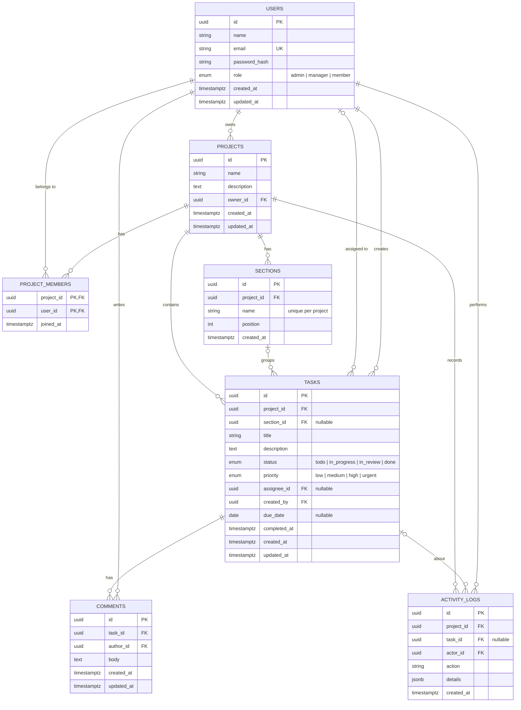

# TaskFlow API

An Asana-style project management REST API. Teams organize work into **projects** and **sections**, then create, assign, and track **tasks** against deadlines, with comments, an activity log, and a progress report per project.

**Stack:** Node.js · Express 5 · TypeScript · Knex · PostgreSQL (Supabase) · Zod · JWT · deployed on Vercel

---

## Features

- **Auth:** register / login with bcrypt-hashed passwords and JWT access tokens
- **Role-based access:** global roles (`admin`, `manager`, `member`) plus project-level ownership and membership checks
- **Projects & sections:** new projects get default "To Do / In Progress / Done" sections; owners add and remove members
- **Task workflows:**
  - **Assignment:** only the project owner or an admin can assign, and only to project members
  - **Status changes:** `todo`, `in_progress`, `in_review`, `done`; `completedAt` is set and cleared automatically
  - **Deadlines:** due dates can't be in the past; tasks expose `isOverdue`; filter by `overdue`, `due_today`, `due_this_week`
- **Search, filter, sort, paginate** on every list endpoint
- **Comments** on tasks, an **activity log** per project, and a **project summary report** (counts by status, overdue count, % complete)
- **Consistent JSON responses** and errors, centralized error handling, request logging
- **Transactions** for multi-step writes (e.g. creating a project with its owner membership and default sections)

---

## Architecture

```
Request → Route → Middleware (auth, role, validation) → Controller → Service → Repository → PostgreSQL
                                                                         ↓
                                                    Error handler ← thrown AppError
```

| Layer | Folder | Responsibility |
|---|---|---|
| Routes | `src/routes` | Map URL + HTTP method to middleware and a controller |
| Middleware | `src/middleware` | Verify the JWT, check global roles, validate input with Zod, handle errors |
| Validators | `src/validators` | Zod schemas describing every body, query, and URL param |
| Controllers | `src/controllers` | Read the validated request, call one service, send the response. No business logic |
| Services | `src/services` | Business rules: permissions, deadlines, assignment, transactions, activity logging |
| Repositories | `src/repositories` | All SQL (via Knex). The only layer that talks to the database |
| Config | `src/config` | Validated environment variables, DB connection, constants |

The database uses `snake_case` and the API uses `camelCase`. Knex's `wrapIdentifier` / `postProcessResponse` hooks convert at the boundary, so application code is camelCase everywhere.

---

## Data model



Deleting a project cascades to its members, sections, tasks, comments, and activity. Deleting a section keeps its tasks (their `section_id` becomes `NULL`).

---

## Roles and permissions

| Action | admin | manager | member |
|---|:-:|:-:|:-:|
| List users, change roles | ✅ | ❌ | ❌ |
| Create a project | ✅ | ✅ | ❌ |
| Update/delete a project, manage members & sections | ✅ any | ✅ own projects | ❌ |
| Create/update tasks, change status, comment | ✅ | ✅ in their projects | ✅ in their projects |
| Assign tasks, delete tasks | ✅ | ✅ own projects | ❌ |
| Delete a comment | ✅ any | ✅ own | ✅ own |
| View summary & activity | ✅ | ✅ in their projects | ✅ in their projects |

New sign-ups get the `member` role; an admin can promote them.

---

## Getting started

### Prerequisites
- Node.js 20+
- A Supabase project (the free tier is fine). Create a **second** Supabase project for local development so you never touch production data.

### 1. Install

```bash
git clone <your-repo-url> taskflow-api
cd taskflow-api
npm install
```

### 2. Configure environment

```bash
cp .env.example .env
```

In Supabase, open **Project Settings → Database → Connection string** and fill in:

| Variable | Value |
|---|---|
| `DATABASE_URL` | **Transaction pooler** URL (port `6543`). Used by the running API |
| `DATABASE_URL_DIRECT` | **Session pooler** or direct URL (port `5432`). Used by migrations and seeds |
| `JWT_SECRET` | At least 32 random characters: `node -e "console.log(require('crypto').randomBytes(48).toString('hex'))"` |

### 3. Migrate, seed, run

```bash
npm run migrate     # create tables
npm run seed        # load demo users, projects, tasks, comments
npm run dev         # http://localhost:3000/api
```

Check that it's up: `curl http://localhost:3000/api/health`

### Demo accounts (password `Password123!`)

| Email | Role |
|---|---|
| admin@taskflow.dev | admin |
| maya@taskflow.dev | manager (owns *Website Redesign*, *Q1 Marketing Campaign*) |
| daniel@taskflow.dev | manager (owns *Mobile App Launch*) |
| priya@taskflow.dev, leo@taskflow.dev, sara@taskflow.dev, omar@taskflow.dev | member |

### Scripts

| Command | Description |
|---|---|
| `npm run dev` | Start with auto-reload |
| `npm start` | Start without reload |
| `npm run typecheck` | TypeScript type check |
| `npm run migrate` | Run pending migrations |
| `npm run migrate:rollback` | Roll back the last migration batch |
| `npm run migrate:make <name>` | Create a new migration file |
| `npm run seed` | Reset tables and load demo data |

---

## Deploying to Vercel

1. Push the repo to GitHub and import it in Vercel. `vercel.json` routes every request to `api/index.ts`, which exports the Express app as a serverless function.
2. Add environment variables in **Vercel → Settings → Environment Variables**: `DATABASE_URL` (transaction pooler, port 6543), `JWT_SECRET`, `DB_POOL_MAX=1`, `NODE_ENV=production`, and optionally `CORS_ORIGIN`.
   If you connect Supabase through the Vercel integration instead, it creates `POSTGRES_URL`, which the app uses automatically when `DATABASE_URL` is not set.
3. Run migrations against the production database from your machine (Vercel does not run them):
   ```bash
   DATABASE_URL_DIRECT="<production session/direct URL>" npm run migrate
   ```
4. Every push to the main branch deploys automatically.

**Why these settings:** each serverless instance opens its own connection pool, so `DB_POOL_MAX=1` plus Supabase's transaction pooler keeps the total connection count low. Migrations need a session connection, so they use the separate direct URL.

---

## API overview

Base URL: `/api`. Protected routes need `Authorization: Bearer <token>`.

| Method | Path | Purpose | Access |
|---|---|---|---|
| GET | `/health` | API + database health | Public |
| POST | `/auth/register` | Create an account | Public |
| POST | `/auth/login` | Get a JWT | Public |
| GET | `/auth/me` | Current user | Any user |
| GET | `/users` | List users (`search`, `role`, pagination) | Admin |
| PATCH | `/users/:userId/role` | Change a user's role | Admin |
| GET | `/projects` | My projects (`search`, `sortBy=createdAt\|name`, `order`, pagination) | Any user |
| POST | `/projects` | Create project | Admin, manager |
| GET | `/projects/:projectId` | Project details | Project member |
| PATCH | `/projects/:projectId` | Update project | Owner, admin |
| DELETE | `/projects/:projectId` | Delete project | Owner, admin |
| GET | `/projects/:projectId/members` | List members | Project member |
| POST | `/projects/:projectId/members` | Add member by email | Owner, admin |
| DELETE | `/projects/:projectId/members/:userId` | Remove member (unassigns their open tasks) | Owner, admin |
| GET | `/projects/:projectId/sections` | List sections in order | Project member |
| POST | `/projects/:projectId/sections` | Create section | Owner, admin |
| PATCH | `/sections/:sectionId` | Rename / reorder section | Owner, admin |
| DELETE | `/sections/:sectionId` | Delete section | Owner, admin |
| GET | `/projects/:projectId/tasks` | List tasks (filters below) | Project member |
| POST | `/projects/:projectId/tasks` | Create task | Project member* |
| GET | `/tasks/:taskId` | Task details | Project member |
| PATCH | `/tasks/:taskId` | Update title, description, priority, due date, section | Project member |
| PATCH | `/tasks/:taskId/assignee` | Assign / unassign | Owner, admin |
| PATCH | `/tasks/:taskId/status` | Change status | Project member |
| DELETE | `/tasks/:taskId` | Delete task | Owner, admin |
| GET | `/me/tasks` | My assigned tasks across projects | Any user |
| GET | `/tasks/:taskId/comments` | List comments | Project member |
| POST | `/tasks/:taskId/comments` | Add comment | Project member |
| DELETE | `/comments/:commentId` | Delete comment | Author, admin |
| GET | `/projects/:projectId/summary` | Status counts, overdue count, % complete | Project member |
| GET | `/projects/:projectId/activity` | Activity log (paginated) | Project member |

\* Setting `assigneeId` when creating a task requires owner or admin.

**Task list query parameters:** `status`, `priority`, `assigneeId`, `sectionId`, `dueStatus=overdue|due_today|due_this_week`, `dueBefore`, `dueAfter` (YYYY-MM-DD), `search` (title), `sortBy=dueDate|priority|createdAt`, `order=asc|desc`, `page`, `limit` (default 20, max 100). `/me/tasks` accepts the same filters plus `projectId`.

Full request and response examples: [docs/API.md](docs/API.md).

### Response format

```jsonc
// Single resource
{ "data": { "id": "…", "title": "…" } }

// List
{ "data": [ … ], "meta": { "page": 1, "limit": 20, "total": 42, "totalPages": 3 } }

// Error
{ "error": { "code": "VALIDATION_ERROR", "message": "Validation failed",
             "details": [ { "field": "body.email", "message": "Invalid email" } ] } }
```

| Status | When |
|---|---|
| 400 | Invalid input, malformed JSON, or a business-rule violation (past due date, assignee not a member) |
| 401 | Missing, invalid, or expired token; wrong credentials |
| 403 | Authenticated but not allowed (wrong role, not a project member/owner) |
| 404 | Resource or route not found |
| 409 | Duplicate (email, member, section name) or conflicting action (removing the project owner) |
| 500 | Unexpected error. Details are logged server-side, never sent to the client |

---

## Project structure

```
├── api/index.ts              # Vercel serverless entry (exports the Express app)
├── migrations/               # Knex migrations, one per table
├── seeds/01_demo_data.ts     # Demo users, projects, tasks, comments
├── src/
│   ├── app.ts                # Express app: security headers, CORS, JSON, logging, routes, errors
│   ├── server.ts             # Local entry (app.listen)
│   ├── config/               # env validation, Knex config, DB instance, constants
│   ├── routes/               # URL → middleware → controller
│   ├── middleware/           # authenticate, requireRole, validate, errorHandler, notFound
│   ├── validators/           # Zod schemas
│   ├── controllers/          # HTTP in/out
│   ├── services/             # Business logic and authorization rules
│   ├── repositories/         # Knex queries
│   ├── types/                # Shared TypeScript types
│   └── utils/                # errors, JWT, passwords, pagination, dates, responses
├── docs/API.md               # Endpoint examples
├── knexfile.ts               # Knex CLI config (migrations, seeds)
├── vercel.json
└── .env.example
```

---

## Design decisions

- **Knex instead of the Supabase JS client:** real migrations, transactions, and plain SQL that works with any Postgres host.
- **Own JWT auth instead of Supabase Auth:** keeps authentication and authorization explicit and visible in the codebase.
- **Authorization in services, not just middleware:** global roles are checked in middleware, but rules like "only the project owner can assign" need data from the database, so they live in `access.service.ts` and are reused by every service.
- **Dates compared in UTC:** `due_date` is a `DATE` column returned as a `YYYY-MM-DD` string, and "today" is computed in UTC so overdue logic doesn't depend on the server's timezone.
- **JWT carries the role:** avoids a database lookup per request. The trade-off is that a role change takes effect when the user's token expires (default 1 day) or when they log in again.
